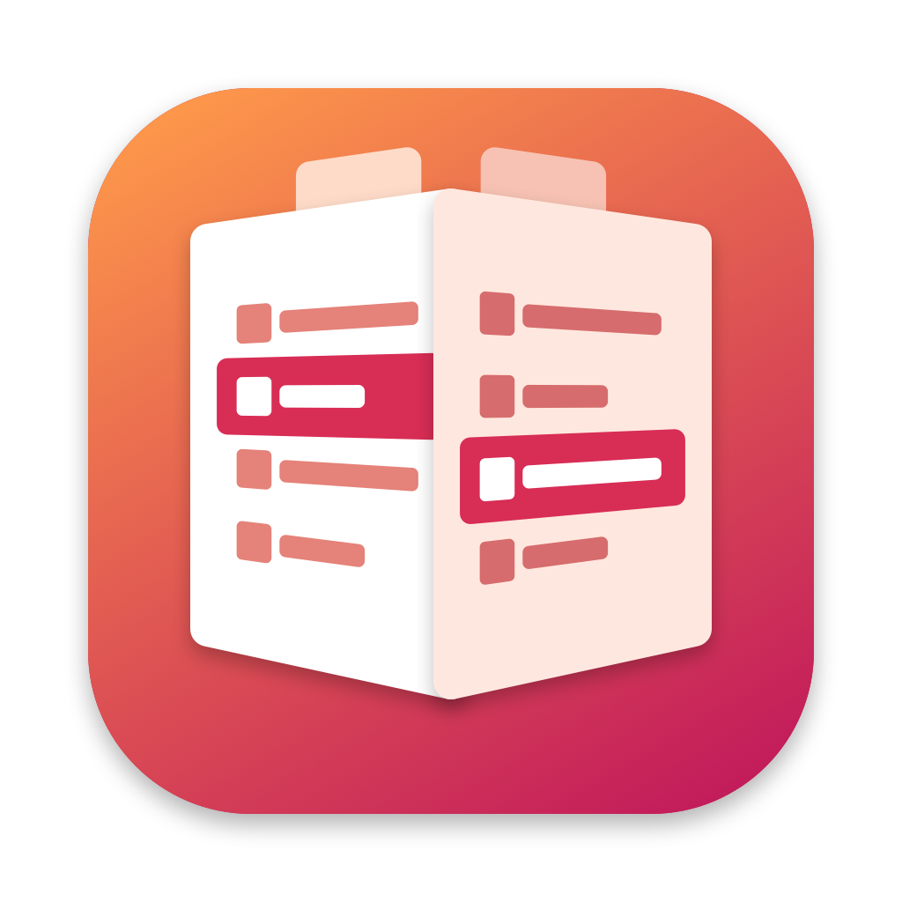

<p align="center"></p>

# Twinfold

**English** | [日本語](README.ja.md)

A small macOS extension that adds a dual-pane view, a drop-down quick window and real cut-and-move to the Finder.
It works by loading a small dylib into Finder. It is not a separate file manager that replaces Finder.

<p align="center">
  <a href="https://youtu.be/GYiVmC6sgkc"></a><br>
  <a href="https://youtu.be/GYiVmC6sgkc">▶ Watch the 50-second video (YouTube)</a>
</p>

<p align="center">
  <a href="https://github.com/luluoneone/twinfold/releases/latest"><b>⬇ Download the latest version</b></a> (free · macOS 14 or later)<br>
  Tested on macOS 27.2.1 (Apple silicon). Not tested on Intel Macs.<br>
  Please read "Before you install" below first.
</p>

## ⚠️ Before you install

Twinfold only works with part of macOS's protection turned off.

- **You must disable System Integrity Protection (SIP).** This lowers the security of your whole Mac. If you are not sure what that means, do not install it.
- On Apple silicon you also need a boot argument and to turn off library validation (see "Required setup" below).
- The app is not notarized by Apple (it is ad-hoc signed). You can read the source and build it yourself.
- No warranty (MIT License). There are quick ways to turn it off if Finder misbehaves (see "Turning it off and uninstalling").

## Features

| Feature | How it works |
|---|---|
| Dual view | `⌘U` switches between two side-by-side panes and one. The right pane opens the same folder. Each pane can have its own tabs. Move one and the other follows |
| Quick window | **control + option + F** (hold control and option at the bottom left of the keyboard, then press F) brings a Finder window up from the bottom of the screen, from any app. Great for dragging files into an editing app or an email. It appears full width on the screen where your mouse is, on every desktop, and hides when you switch apps (or stays if pinned). The height you drag it to is remembered |
| Cut and move | `⌘X` a file, then `⌘V` in the destination. Copying something else or pressing `esc` in between turns it back into a normal paste. While you are typing (renaming a file), it is the usual text cut and paste |
| Hidden files, folders on top | Toggle from the menu bar (hidden files also with Finder's own `⌘⇧.`) |
| Tabs | Uses Finder's own tabs (`⌘T`, `⌘W`, `⌃⇥`) |

Finder's Window menu also gets "Dual View", "Show/Hide Quick Window" and "Pin Quick Window".

### Settings (Finder Settings → Twinfold)

A "Twinfold" tab appears to the right of "Advanced" in the toolbar of Finder Settings (`⌘,`). You can also open it with "More Settings…" in the menu bar menu.

- Turn the quick window on or off
- Hotkey: click the button, then press the new keys. A modifier is required; `esc` cancels
- Height, and when to hide
- Turn dual view and cut-and-move on or off
- "Turn Off for Now" and "Uninstall…" buttons
- Language (Same as macOS, 日本語, English)

## Manual

The user manual is [docs/manual/Twinfold-Manual-EN.pdf](docs/manual/Twinfold-Manual-EN.pdf) (14 pages, with a diagram of where the keys are).
The Japanese edition is [docs/manual/Twinfold-Manual-JA.pdf](docs/manual/Twinfold-Manual-JA.pdf).
You can also open it from "Open Manual" in the menu bar, or the "Manual" button in the Twinfold tab of Finder Settings.
The sources are [docs/manual/MANUAL_EN.md](docs/manual/MANUAL_EN.md) and [MANUAL_JA.md](docs/manual/MANUAL_JA.md) (`./build.sh manual` builds both PDFs).

## Language

Menus, the settings tab, the items added to Finder's Window menu and the dialogs are available in English and Japanese.
The default is "Same as macOS": Japanese if your first macOS language is Japanese, English otherwise.
Switch it from "Language" in the menu bar, or at the bottom of the Twinfold tab in Finder Settings.

## Requirements

| Item | Details |
|---|---|
| macOS | 14 or later. Tested on macOS 27.2.1, 27.2 and 26.6.2 (Apple silicon) |
| CPU | Apple silicon. An Intel slice is built too, but **it has not been tested on an Intel Mac** |
| Build | clang from the Command Line Tools (Xcode is not required) |

## Required setup

All three settings stay in place after macOS updates (confirmed on 27.2).

1. **Disable SIP**: start up in Recovery mode (on Apple silicon, hold the power button and choose Options), run the following in Terminal, and restart.
   ```bash
   csrutil disable
   ```
2. **Add the boot argument** (Apple silicon only), then restart. If you already use other boot arguments, list them together.
   ```bash
   sudo nvram boot-args=-arm64e_preview_abi
   ```
3. **Turn off library validation**:
   ```bash
   sudo defaults write /Library/Preferences/com.apple.security.libraryvalidation.plist DisableLibraryValidation -bool true
   ```

Check them with `csrutil status`, `nvram boot-args` and `defaults read /Library/Preferences/com.apple.security.libraryvalidation.plist`.
If anything is missing, Twinfold leaves Finder alone and tells you what is missing in a dialog.

To undo them, uninstall Twinfold first, then:
- Run `csrutil enable` in Recovery mode
- Run `sudo nvram -d boot-args`
- Run `sudo defaults delete /Library/Preferences/com.apple.security.libraryvalidation.plist DisableLibraryValidation`

## Installing

### Release build (ZIP)

1. Download `Twinfold-<version>.zip` from [Releases](https://github.com/luluoneone/twinfold/releases/latest) (not "Source code", which is the source for building it yourself), unzip it, and move `Twinfold.app` to `/Applications` (or `~/Applications`).
2. Because it is not notarized, macOS blocks the first launch. Remove the download mark with this command, then open it.
   ```bash
   xattr -dr com.apple.quarantine /Applications/Twinfold.app
   ```
3. Finder restarts once and the Twinfold icon appears in the menu bar. To start it automatically, choose "Open at Login" from its menu.

### Building from source

```bash
./build.sh            # unit tests, then build (warnings are errors)
./build.sh test       # unit tests only
./build.sh install    # build, install to ~/Applications/Twinfold.app and open it
./build.sh dist       # build and make dist/Twinfold-<version>.zip
./build.sh manual     # build both manual PDFs (needs python3, reportlab and the M PLUS 1 font)
```

When you install a new version, Twinfold notices the old version running in Finder and reloads itself (Finder restarts once).
To redraw the icon, run `tools/make_icon.sh` (it writes `Sources/Resources/Twinfold.icns`).

## Turning it off and uninstalling

| What you want | How |
|---|---|
| Turn it off for now | "Turn Twinfold Off" in the menu bar, or "Turn Off for Now" in the settings tab. Finder restarts as the normal Finder, and it stays off after you log in again. Turn it back on with "Turn Twinfold On" |
| Start without loading it when Finder misbehaves | Hold `shift` while opening Twinfold.app and keep holding it for about a second (it stays off until you quit it) |
| Uninstall | "Uninstall…" in the menu bar or the settings tab. It does the four things below |

Uninstalling:
- Restores the normal Finder
- Removes the login item
- Deletes the settings file (`~/Library/Preferences/com.lulu.twinfold.plist`)
- Moves `Twinfold.app` to the Trash

Finder's own settings (hidden files, folders on top) are not changed.

If Finder could not quit (because it was copying files, for example), the running Finder still has Twinfold loaded after uninstalling.
Relaunch Finder when it is done (option-right-click Finder in the Dock and choose Relaunch) to remove it completely.

## How it works

```
Twinfold.app (menu bar agent, arm64 / x86_64)
  └─ quits Finder and relaunches it with DYLD_INSERT_LIBRARIES=TwinfoldCore.dylib
       └─ TwinfoldCore.dylib (arm64e / x86_64, runs inside Finder)
            ├─ TWFQuickWindow … Carbon hotkey, NSWindow position and alpha animation
            ├─ TWFDual        … pairs two Finder windows as parent/child windows side by side
            ├─ TWFSettings    … adds a "Twinfold" tab to the Finder Settings toolbar
            └─ TWFCore        … maps ⌘X/⌘V to the "Copy" and "Move Items Here" menu items
```

- **It does not depend on Finder's private classes.** It only uses key events, menu items (found by their action selectors) and public NSWindow APIs.
  Extensions that reach deep into Finder break easily with macOS updates, so Twinfold avoids that on purpose.
- The agent watches Finder launch and quit, and reloads itself when a normal Finder starts.
  If that happens more than three times in two minutes, it stops and restores the normal Finder (so Finder does not keep crashing).
- If Finder will not quit (while copying, for example), Twinfold never force-quits it.
- Finder is launched with `responsibility_spawnattrs_setdisclaim`, so folder access permissions belong to Finder itself.
- The settings tab wraps the toolbar delegate in a proxy that returns only the Twinfold item and forwards everything else to Finder.
  The toolbar configuration is not saved, so nothing is left in Finder Settings after uninstalling.
- UI text is written as Japanese/English pairs (`TWFText` in `Sources/Shared/TWFShared.h`) and read from the `Language` setting, which both the agent and the code inside Finder read through CFPreferences.

### Notes from macOS 27.2

- Finder's executable now contains `arm64e` and `arm64e.x1` (no more x86_64). The arm64e dylib loads as is.
- SIP being disabled and `-arm64e_preview_abi` both survived the update.
- In the agent, passing its own bundle ID to `NSUserDefaults initWithSuiteName:` made the settings unreadable (on 26 it was only a warning).
- Replacing the content of the Finder Settings window, or resizing it, made Finder keep resizing until it crashed (an `_enumeratingSubviewsCount` assertion). The settings are therefore drawn as an overlay.

### Logs

```bash
/usr/bin/log stream --predicate 'subsystem == "com.lulu.twinfold"'
```

## Tested on real hardware

macOS 27.2 and 27.2.1 (Apple silicon, November 2026; 0.5.0 was checked on 27.2.1):
- Loading: agent launch, reloading after `killall Finder`, reloading after a version change
- Settings tab: appears to the right of Advanced; switching between it and General, Advanced and Sidebar repeatedly does not crash
- Turn off for now: Finder returns to normal, and turning it back on reloads Twinfold
- Uninstall: Finder returns to normal, the app goes to the Trash, the settings are removed
- Showing and hiding the quick window, splitting into dual view
- Clicking Finder in the Dock opens a new window even while the quick window is hidden (fixed in 0.3.1)
- Pressing control + option + F on a real keyboard shows the quick window (Japanese layout)
- The "Manual" button in the settings tab opens the PDF
- English/Japanese switching (0.5.0): with the settings tab open, it is rebuilt on the spot, and the items in Finder's Window menu switch too. "Same as macOS" picks Japanese on a Japanese Mac. The English manual screenshots were taken with Finder running in English
- Safe mode now requires shift to be held both at launch and 0.6 seconds later, so a shift pressed while typing does not trigger it by accident (0.5.0)

macOS 26.6.2:
- Unit tests (`tests/test_logic.c`)
- Reloading, quick window, dual view
- Cut and move: `⌘X`, then `⌘V` in another folder moves the file

## Not yet tested / known limitations

- If future macOS changes the rules for `DYLD_INSERT_LIBRARIES` or `-arm64e_preview_abi`, Twinfold will stop loading.
- Not yet tried on real hardware:
  - Intel Macs
  - Dual view and tabs inside the quick window
  - Toggling "Keep Folders on Top" and "Show Hidden Files" from the menu
  - Open at Login
  - Changing the hotkey in the settings tab
  - Turning it on and off from the menu bar (same code path as the settings buttons)
  - Switching the language from "Language" in the menu bar (writes the same setting and sends the same signal as the settings tab)
- The settings tab scrolls if the Finder Settings tab you had open before was small.
- Once, after restoring the normal Finder in safe mode, Finder did not finish launching and stopped responding (no windows, could not quit). The cause is unknown. If it happens, quit Finder in Activity Monitor and macOS relaunches it.
- Files waiting to be moved are not dimmed.

## License

MIT License ([LICENSE](LICENSE)).
