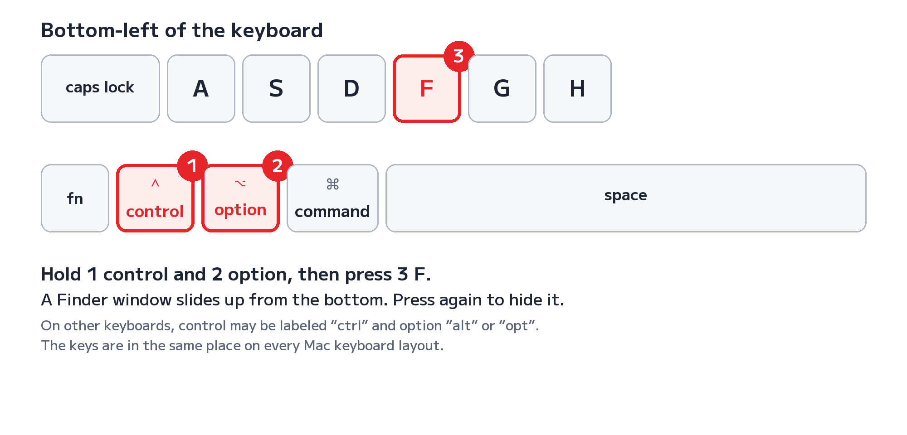
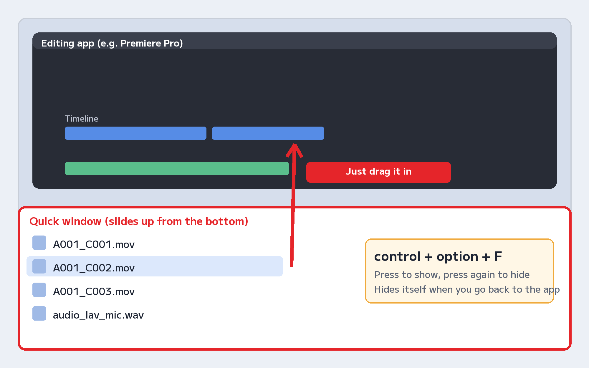
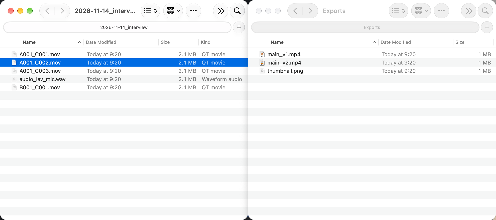
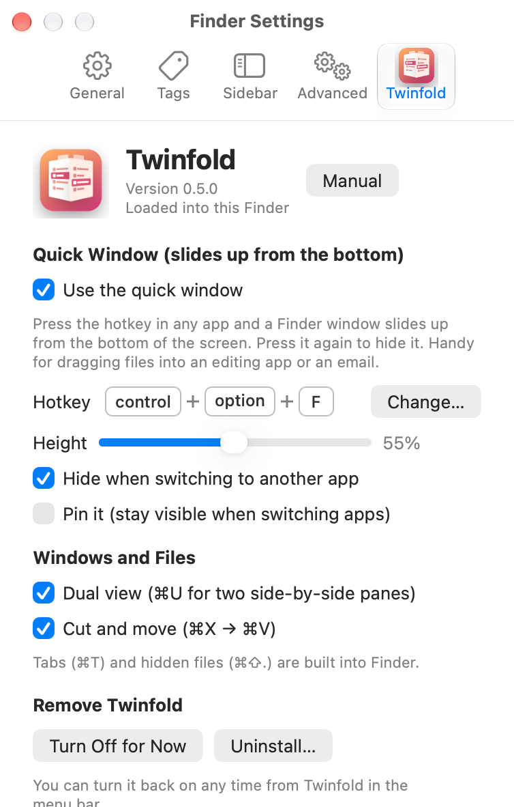

# Twinfold User Manual

Version: 0.5.0
Updated: 2026-11-19
Publisher: LULU Apps

> A free Finder extension for the Mac that adds a quick window that slides up from the bottom, a two-pane dual view, and real cut-and-move.

<!-- icon: ../../Sources/Resources/Twinfold.icns -->
<!-- cover: 01|Quick window|Bring up Finder from any app ; 02|Dual view|Two folders side by side ; 03|Cut and move|Cut files and move them -->
<!-- footer: Universal (Apple silicon and Intel) · macOS 14 or later · Free (MIT License) -->

## 00 Read This First

**Twinfold is a power-user tool that only works with part of macOS's protection turned off.** It adds features by loading a small library into Finder, which requires turning off System Integrity Protection (SIP).

> Warning: Turning off SIP lowers the security of your whole Mac. If you are not sure what SIP is, or your Mac is managed by your company or school, do not use Twinfold.

- Supported Macs: macOS 14 or later. Tested on macOS 27.2 and 26.6.2 (Apple silicon). The app is also built for Intel, but it has not been tested on an Intel Mac.
- Required setup: turn off SIP, add a boot argument, and turn off library validation (chapter 04).
- Price: free. No account or internet connection is needed.
- Twinfold is not a separate file manager. You keep using the regular Finder, with extra features added.
- If something feels wrong, you can go back to the normal Finder right away (chapter 10).

<!-- include: gatekeeper | Twinfold.app -->

## 01 Introduction

Twinfold was made as a replacement for a long-loved Finder extension that is no longer developed. When you work with video or photo footage, you jump between Finder and your editing app all day. Twinfold makes that back-and-forth shorter.

### What Twinfold does

- **Quick window**: press the hotkey (control + option + F by default) in any app, and a Finder window slides up from the bottom of the screen. Press it again, or go back to your app, and it hides
- **Dual view**: press ⌘U to split a Finder window into two side-by-side panes, each showing its own folder
- **Cut and move**: press ⌘X on a file, then ⌘V in another folder, and the file is moved instead of copied
- Switches hidden files and "Keep Folders on Top" from the menu bar
- Adds a "Twinfold" tab to Finder Settings (⌘,) that holds all of its settings
- Shows its menus and settings in English or Japanese (by default it follows your macOS language)

### What Twinfold does not do

- It does not rewrite Finder's internals. It only uses keyboard events, menus, and the public window features of macOS
- It does not change any Mac settings other than Finder's own options (such as hidden files)
- Tabs are Finder's own tabs (⌘T). Twinfold does not add its own tabs
- It does not dim files that are waiting to be moved

## 02 Quick Start

After installing (chapter 05), try these three things.

1. **Quick window**: hold control and option, then press F. A Finder window slides up from the bottom of the screen. Press the same keys again to hide it.
2. **Dual view**: open a Finder window and press ⌘U. The same folder opens on the right. Press ⌘U again to go back to one pane.
3. **Cut and move**: select a file and press ⌘X, open another folder and press ⌘V. The file moves.

If you are not sure where these keys are, see chapter 03.

## 03 Where the Keys Are

Mac shortcuts are often written with symbols that do not match what is printed on the keys, so this manual uses the key names.



| Symbol | Key name | Where it is |
|---|---|---|
| ⌃ | control (ctrl) | Bottom left, right of fn |
| ⌥ | option (alt, opt) | Right of control |
| ⌘ | command | Right of option, left of the space bar |
| ⇧ | shift | Both edges, below the A row |

"⌘U" means hold command and press U. "⌘X → ⌘V" means press command + X, then command + V.

> You can change the quick window hotkey to any combination in the Twinfold tab of Finder Settings (chapter 09).

## 04 Required Setup

All three settings stay in place after macOS updates (confirmed on macOS 27.2). If anything is missing when you open Twinfold, it shows what is missing and leaves Finder alone.

### 1. Turn off SIP

1. Start your Mac in Recovery mode. On Apple silicon, shut the Mac down, then press and hold the power button and choose Options.
2. Choose Utilities > Terminal from the menu bar, type the following, and press return.

```
csrutil disable
```

3. Press `y` when asked and enter your Mac password. Then restart.

### 2. Add the boot argument (Apple silicon only)

Run the following in the regular Terminal (Applications > Utilities > Terminal), then restart your Mac.

```
sudo nvram boot-args=-arm64e_preview_abi
```

> Note: This replaces any boot arguments you already use. Check the current value with `nvram boot-args` first, and if needed, list them together separated by spaces.

### 3. Turn off library validation

```
sudo defaults write /Library/Preferences/com.apple.security.libraryvalidation.plist DisableLibraryValidation -bool true
```

### Check your settings

| Command | Expected result |
|---|---|
| `csrutil status` | Shows `disabled` |
| `nvram boot-args` | Includes `-arm64e_preview_abi` (Apple silicon) |
| `defaults read /Library/Preferences/com.apple.security.libraryvalidation.plist` | `DisableLibraryValidation = 1` |

Chapter 12 explains how to undo these settings.

## 05 Installing and Opening

1. Unzip the download and move "Twinfold.app" to your Applications folder.
2. Double-click Twinfold.app. If macOS says it cannot be opened, follow "First launch only" in chapter 00.
3. Finder quits and reopens once (a few seconds). Twinfold is ready when its icon (a rectangle split in two) appears at the right end of the menu bar.
4. To use Twinfold every time you start your Mac, choose "Open at Login" from its menu bar icon.

> If macOS says "Twinfold is damaged and can't be opened", run `xattr -dr com.apple.quarantine /Applications/Twinfold.app` in Terminal, then open it again. This removes the mark that macOS adds to downloaded files.

### Updating to a new version

Replace the old Twinfold.app with the new one and open it. Twinfold notices the older version running in Finder and reopens Finder once to load the new one. Your settings are kept.

## 06 Quick Window

### What it is for

The quick window is **a Finder you call up to grab files while you are working in another app**.



It saves you from rearranging windows or hunting for Finder in the Dock in moments like these:

- Dragging footage or music into an editing app (Premiere Pro, After Effects, Final Cut Pro, and so on)
- Attaching files to an email, a chat, or a browser upload page
- Checking where an export ended up without leaving your work
- Moving a download straight into your project folder

The quick window remembers the last folder you opened. Every time it appears it starts in the same place, so if you leave your project folder open you can get back to it instantly.

### Showing and hiding it

| Action | What happens |
|---|---|
| control + option + F | Slides up from the bottom, full width, on the screen where your mouse is |
| control + option + F again | Hides and returns you to the app you were using |
| Click another app | Hides automatically (unless it is pinned) |
| Drag the top edge | Changes the height. The new height is used next time |

"Show/Hide Quick Window" is also in Twinfold's menu bar menu and in Finder's Window menu.

### What you can do inside it

The quick window is a regular Finder window. You can open folders, drag files, rename, move files with ⌘X → ⌘V, and use Finder tabs (⌘T).

### Keeping it on screen (pinning)

When you need to drag several files in a row, choose "Pin Quick Window" from Finder's Window menu. It then stays visible when you switch apps. Choose it again to undo.

## 07 Dual View


<!-- mark: box 0.005,0.01,0.49,0.98 Left pane ; box 0.505,0.01,0.49,0.98 Right pane ; arrow 0.30,0.30,0.70,0.40 Drag or ⌘X → ⌘V between panes -->

1. Open a Finder window and press ⌘U. The window splits in two, and the same folder opens on the right.
2. Open another folder on the right. Drag files between the panes, or move them with ⌘X → ⌘V.
3. Press ⌘U again to go back to one pane. If the right pane has only one tab it closes; if it has several, it stays open.

- The two panes are two Finder windows. Each one can have its own tabs (⌘T).
- Move or resize one and the other follows.
- Close one and the other expands to the original size.

## 08 Cut and Move

The regular Finder does not let you cut files with ⌘X. With Twinfold you can move them like this:

1. Select the files you want to move and press ⌘X (nothing happens to the files yet).
2. Open the destination folder and press ⌘V. The files move.

- If you copy something else or press esc after ⌘X, the cut is canceled and ⌘V pastes normally.
- While you are typing (for example, renaming a file), ⌘X and ⌘V cut and paste text as usual.
- The move uses Finder's own "Move Items Here". If a file with the same name exists, Finder asks what to do.

## 09 Settings and the Menu Bar

### The Twinfold tab in Finder Settings

Bring Finder to the front and press ⌘, (command + comma) to open Finder Settings, then choose "Twinfold" to the right of "Advanced" in the toolbar. You can also open it with "More Settings…" in the menu bar menu.


<!-- mark: box 0.585,0.198,0.2,0.052 Open the manual ; box 0.188,0.465,0.48,0.06 Current hotkey ; box 0.715,0.473,0.235,0.047 Change the hotkey ; box 0.05,0.574,0.68,0.04 Hide when switching apps ; box 0.055,0.898,0.605,0.05 Turn off or uninstall -->

| Item | What it does |
|---|---|
| Use the quick window | When off, the hotkey does nothing |
| Hotkey | The current key combination. Click "Change…", then press a new combination. It must include control, option or command. Press esc to cancel |
| Height | Height as a share of the screen (20–90%) |
| Hide when switching to another app | When off, it stays visible until you hide it |
| Pin it | Stays visible when you switch apps (same as "Pin Quick Window" in the Window menu) |
| Dual view / Cut and move | Turns each feature on or off |
| Turn Off for Now / Uninstall… | Chapter 10 |
| Language | Choose "Same as macOS", "日本語" (Japanese) or "English". At the bottom of the tab |

> When you change the hotkey, pick a combination no other app uses. If two apps share it, only one of them works. For example, the ChatGPT app uses option + space.

### Twinfold in the menu bar

Click the icon at the top right of the screen (a rectangle split in two) to open this menu.

| Item | What it does |
|---|---|
| Loaded into Finder (first line) | The current state. If Twinfold has stopped, the reason is shown here |
| Turn Twinfold Off / On | Go back to the normal Finder, or use Twinfold again (chapter 10) |
| Show/Hide Quick Window | Same as the hotkey |
| Feature switches | Quick window, hide when switching, pin, dual view, cut and move |
| More Settings… | Opens the Twinfold tab in Finder Settings |
| Keep Folders on Top | When sorted by name, folders come first (Finder restarts to apply it) |
| Show Hidden Files | Also shows files whose names start with "." (also ⌘⇧.) |
| Open at Login | Opens Twinfold automatically when you log in |
| Reload into Finder | Reopens Finder and loads Twinfold again |
| Open Manual | Opens this manual (the Japanese edition when the language is Japanese) |
| Language | Choose "Same as macOS", "日本語" (Japanese) or "English" |
| Uninstall… | Chapter 12 |
| Quit Twinfold | Quits Twinfold only. The running Finder stays as it is |

## 10 Turning It Off Quickly

If Finder seems off, first turn Twinfold off and check whether the same thing happens with the normal Finder.

| What you want | How |
|---|---|
| Turn it off for now | "Turn Twinfold Off" in the menu bar, or "Turn Off for Now" in the settings tab. Finder restarts as the normal Finder. It stays off after you log in again |
| Turn it back on | "Turn Twinfold On" in the menu bar |
| Start without loading it, just this once | Hold shift while opening Twinfold.app, and keep holding it for about a second. Twinfold does not load into Finder until it is quit |

> If Finder cannot quit because it is busy (copying files, for example), Twinfold does not force it to quit. Try again when Finder is done.

## 11 Troubleshooting

### Nothing happens when I press the hotkey

1. Open Twinfold's menu bar menu and check that the first line says "Loaded into Finder". If it does not, follow the reason shown there.
2. If you see "Could not register the quick window hotkey", another app is using the same combination. Change it as described in chapter 09.
3. Check that "Use the quick window" is on in the settings tab.

### Clicking Finder in the Dock does not open a window

Up to version 0.3.0, this happened after the quick window had been hidden once. It was fixed in 0.3.1. Check the version at the bottom of the menu bar menu and update if it is older.

### "macOS is not set up to load it into Finder"

One of the three settings in chapter 04 is missing; the message tells you which. Set it up, restart your Mac, and open Twinfold again.

### Finder quit several times and Twinfold stopped

If Finder quits more than three times in two minutes, Twinfold stops itself and restores the normal Finder so that Finder does not keep crashing. Choose "Reload into Finder" in the menu bar to start again. If it keeps happening, search for `com.lulu.twinfold` in the Console app to see what happened.

### Finder does not respond (no windows open and it will not quit)

This happened once while Finder was being restored to normal (the cause is still under investigation). Quit Finder in Activity Monitor and macOS reopens it.

### The bottom of the settings tab is cut off

The settings tab fits inside the window size that Finder chooses. Scroll inside the tab to see the rest.

## 12 Uninstalling

Choose "Uninstall…" in the menu bar or in the settings tab, then click "Uninstall" to confirm. Twinfold then:

- Restores the normal Finder
- Removes its login item
- Deletes its settings (`~/Library/Preferences/com.lulu.twinfold.plist`)
- Moves Twinfold.app to the Trash

Finder's own settings (hidden files, Keep Folders on Top) are not changed.

### Restoring the macOS settings

Uninstalling does not undo the three settings you changed for Twinfold. To undo them, in this order:

1. Run `sudo defaults delete /Library/Preferences/com.apple.security.libraryvalidation.plist DisableLibraryValidation` in Terminal.
2. Run `sudo nvram -d boot-args` in Terminal (if you also had other values, set just those again).
3. Run `csrutil enable` in Terminal in Recovery mode, then restart.

## 13 License and Terms

### License

Twinfold is free software released under the MIT License. The source code is on GitHub. You may use, modify and share it, as long as you keep the copyright notice and the license text.

### No warranty

Twinfold comes with no warranty. Because it runs with part of macOS's protection turned off, it may affect how Finder or your Mac behaves. Back up important data and use it at your own discretion.

### Trademarks

Finder, Mac and macOS are trademarks of Apple Inc. Twinfold is an independent project and is not affiliated with Apple.
