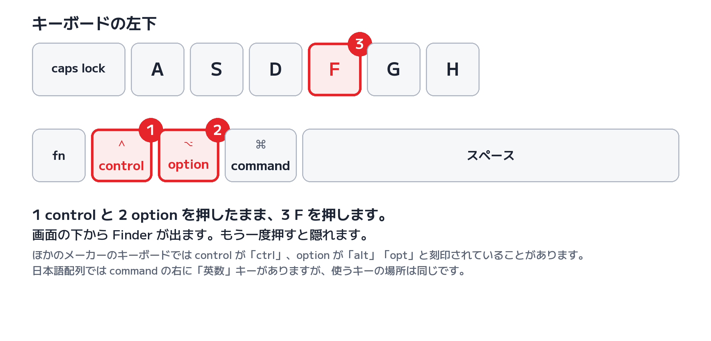
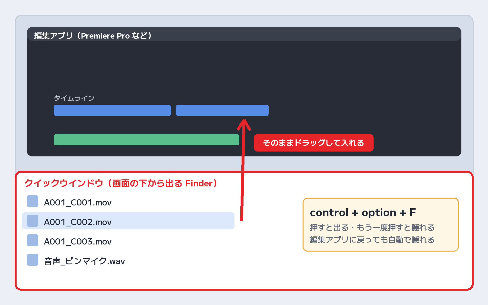
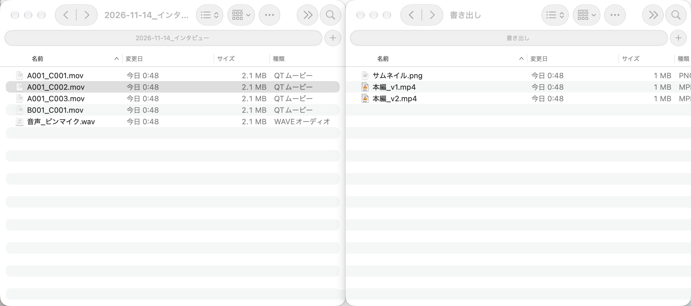
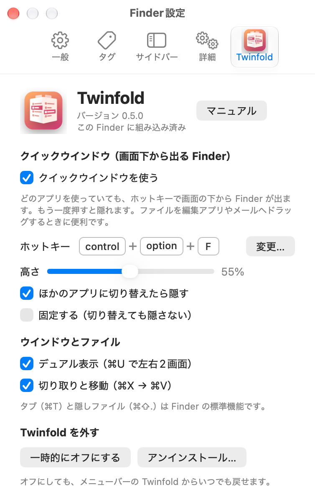

# Twinfold ユーザーマニュアル

対象バージョン: 0.5.0
更新日: 2026-11-19
提供: LULU Apps

> Mac の Finder に、画面の下から出るクイックウインドウ、左右2画面のデュアル表示、本当の「切り取りと移動」を足す無料の拡張です。

<!-- icon: ../../Sources/Resources/Twinfold.icns -->
<!-- cover: 01|クイックウインドウ|どのアプリからでも Finder を出す ; 02|デュアル表示|左右2画面でフォルダを並べる ; 03|切り取りと移動|ファイルを切り取って移動する -->
<!-- footer: Universal（Apple Silicon・Intel）・macOS 14以上・無料（MIT ライセンス） -->

## 00 最初にお読みください

**Twinfold は、macOS の保護を一部外さないと動かない上級者向けのツールです。** Finder の中に小さなプログラムを読み込ませて機能を足すため、Apple が用意している「システム整合性保護（SIP）」を無効にする必要があります。

> 注意：SIP を無効にすると、Mac 全体の安全性が下がります。SIP が何か分からない場合や、会社・学校から管理されている Mac では使わないでください。

- 対象：macOS 14以上の Mac。macOS 27.2 と 26.6.2（Apple Silicon）で確認しています。Intel 用も入れてビルドしていますが、Intel の Mac では試していません。
- 必要な設定：SIP の無効化、起動設定（boot-args）の追加、ライブラリ検証の無効化の3つです（04章）。
- 料金：無料です。アカウントもネット接続も要りません。
- Finder を置き換える別のファイラーではありません。いつもの Finder がそのまま使え、そこに機能が足されます。
- 調子が悪いときは、すぐに通常の Finder に戻せます（10章）。

<!-- include: gatekeeper | Twinfold.app -->

## 01 はじめに

Twinfold は、長く使われてきた Finder 拡張の代わりとして作りました。映像や写真の素材を扱う仕事では、Finder と編集アプリのあいだを何度も行き来します。その往復を少しでも短くするための道具です。

### このアプリが行うこと

- **クイックウインドウ**：ホットキー（標準は control＋option＋F）を押すと、どのアプリを使っていても画面の下から Finder が出ます。もう一度押すか、ほかのアプリに戻ると隠れます
- **デュアル表示**：⌘U で Finder のウインドウを左右2画面にします。左右それぞれで別のフォルダを開けます
- **切り取りと移動**：ファイルを ⌘X で切り取り、移動先で ⌘V を押すと、コピーではなく移動になります
- 隠しファイルの表示と「フォルダを常に上に表示」を、メニューバーから切り替えます
- Finder 設定（⌘,）に「Twinfold」タブを足し、設定をまとめます
- 画面の文字を日本語と英語で切り替えられます（標準は macOS の言語に合わせる）

### このアプリが行わないこと

- Finder の中身（内部の仕組み）を書き換えません。キー操作、メニュー、ウインドウの公開されている機能だけを使います
- Finder 自体の設定（隠しファイルなど）以外は、Mac の設定を変えません
- タブは Finder 標準のタブ（⌘T）をそのまま使います。独自のタブは作りません
- 切り取り中のファイルを薄く表示する機能はありません

## 02 最短の使い方

インストールが終わったら（05章）、次の3つを試してください。

1. **クイックウインドウ**：control と option を押したまま F を押します。画面の下から Finder が出ます。もう一度同じキーを押すと隠れます。
2. **デュアル表示**：Finder のウインドウを開いて ⌘U を押します。右に同じフォルダが開きます。もう一度 ⌘U で1画面に戻ります。
3. **切り取りと移動**：ファイルを選んで ⌘X、別のフォルダを開いて ⌘V。ファイルが移動します。

キーの場所が分からないときは、次の03章を見てください。

## 03 キーの場所

Mac のショートカットは記号で書かれることが多く、キーボードの刻印と結びつきにくいので、このマニュアルではキーの名前で書きます。



| 記号 | キーの名前 | 場所 |
|---|---|---|
| ⌃ | control（ctrl） | 左下。fn の右 |
| ⌥ | option（alt・opt） | control の右 |
| ⌘ | command | option の右。スペースの左 |
| ⇧ | shift | 左右の端。A の段の下 |

「⌘U」は command を押したまま U、「⌘X → ⌘V」は command＋X のあとに command＋V、という意味です。

> クイックウインドウのホットキーは、Finder 設定の「Twinfold」タブで好きな組み合わせに変えられます（09章）。

## 04 必要な設定

3つとも、一度設定すれば macOS をアップデートしても残ります（macOS 27.2 で確認）。設定が足りないまま Twinfold を開くと、足りない項目がダイアログで表示され、Finder には何もしません。

### 1. SIP を無効にする

1. Mac を復旧モードで起動します。Apple Silicon の Mac は、電源を切った状態で電源ボタンを長押しし、「オプション」を選びます。
2. メニューの「ユーティリティ」から「ターミナル」を開き、次を入力して return を押します。

```
csrutil disable
```

3. 確認が出たら `y` を押し、Mac のパスワードを入れます。終わったら再起動します。

### 2. 起動設定（boot-args）を追加する（Apple Silicon のみ）

いつものターミナル（アプリケーション → ユーティリティ → ターミナル）で次を実行し、Mac を再起動します。

```
sudo nvram boot-args=-arm64e_preview_abi
```

> 注意：ほかの理由で boot-args を設定している場合は、上書きされます。先に `nvram boot-args` で今の値を確かめ、必要なら空白で区切って並べて書いてください。

### 3. ライブラリ検証を無効にする

```
sudo defaults write /Library/Preferences/com.apple.security.libraryvalidation.plist DisableLibraryValidation -bool true
```

### 設定を確かめる

| 確かめるコマンド | 正しい状態 |
|---|---|
| `csrutil status` | `disabled` と表示される |
| `nvram boot-args` | `-arm64e_preview_abi` が含まれる（Apple Silicon） |
| `defaults read /Library/Preferences/com.apple.security.libraryvalidation.plist` | `DisableLibraryValidation = 1` |

元に戻す方法は12章にあります。

## 05 インストールと起動

1. ダウンロードした ZIP を展開し、「Twinfold.app」を「アプリケーション」フォルダへ移動します。
2. Twinfold.app をダブルクリックします。初回に「開けません」と表示されたら、00章の「初回だけ必要な操作」を行います。
3. 開くと Finder が一度閉じて、すぐに開き直します（数秒）。メニューバーの右上に Twinfold のアイコン（左右に分かれた四角）が出れば準備完了です。
4. Mac を起動するたびに自動で使うには、メニューバーのアイコンから「ログイン時に起動」を選びます。

> 「“Twinfold”は壊れているため開けません」と表示されたときは、ターミナルで `xattr -dr com.apple.quarantine /Applications/Twinfold.app` を実行してから開きます。ダウンロードしたファイルに付く印を外すコマンドです。

### 新しい版に入れ替えるとき

古い Twinfold.app を新しいものに置き換えて開きます。Twinfold は Finder の中の古い版に気づき、Finder を一度開き直して新しい版にします。設定はそのまま引き継がれます。

## 06 クイックウインドウ

### 何に使うのか

クイックウインドウは、**ほかのアプリを使っている最中に、ファイルを取りに行くための Finder** です。



たとえば次のような場面で、ウインドウを並べ直したり Dock から Finder を探したりする手間がなくなります。

- 編集アプリ（Premiere Pro、After Effects、Final Cut Pro など）に、素材の動画や音楽をドラッグで読み込む
- メールやチャット、ブラウザのアップロード画面に、ファイルをドラッグで添付する
- 書き出したファイルがどこにできたかを、作業を中断せずに確かめる
- ダウンロードしたファイルを、すぐに作業フォルダへ移す

クイックウインドウは、最後に開いていたフォルダを覚えています。出すたびに同じ場所から始まるので、作業中のフォルダを開いておけば、何度でもすぐに戻れます。

### 出す・隠す

| 操作 | 動き |
|---|---|
| control＋option＋F | 画面の下から出る。マウスのある画面に、横いっぱいの幅で出る |
| もう一度 control＋option＋F | 隠れる。直前に使っていたアプリに戻る |
| ほかのアプリをクリックする | 自動で隠れる（「固定」していないとき） |
| 上の端をドラッグする | 高さが変わる。次からその高さで出る |

メニューバーの Twinfold のメニューと、Finder の「ウインドウ」メニューにも「クイックウインドウを表示／隠す」があります。

### 中で使えること

クイックウインドウの中身は普通の Finder のウインドウです。フォルダの移動、ファイルのドラッグ、名前の変更、⌘X → ⌘V での移動、Finder のタブ（⌘T）がそのまま使えます。

### 隠さずに出しておく（固定）

ドラッグを何度も続けるときは、Finder の「ウインドウ」メニューの「クイックウインドウを固定」を選びます。ほかのアプリに切り替えても隠れなくなります。もう一度選ぶと元に戻ります。

## 07 デュアル表示


<!-- mark: box 0.005,0.01,0.49,0.98 左のウインドウ ; box 0.505,0.01,0.49,0.98 右のウインドウ ; arrow 0.30,0.30,0.70,0.40 左右のあいだでドラッグ・⌘X → ⌘V -->

1. Finder のウインドウを開いて ⌘U を押します。ウインドウが左右に分かれ、右に同じフォルダが開きます。
2. 右のウインドウで別のフォルダを開きます。左右のあいだでファイルをドラッグしたり、⌘X → ⌘V で移動したりできます。
3. もう一度 ⌘U を押すと1画面に戻ります。右のウインドウにタブが1つしかなければ閉じ、タブが複数あれば残します。

- 左右は2枚の Finder のウインドウです。それぞれでタブ（⌘T）を使えます。
- どちらかを動かしたり大きさを変えたりすると、もう片方も付いてきます。
- 片方を閉じると、残ったほうが元の大きさに広がります。

## 08 切り取りと移動

普通の Finder では ⌘X でファイルを切り取れません。Twinfold では次のように移動できます。

1. 移動したいファイルを選び、⌘X を押します（この時点ではファイルはそのままです）。
2. 移動先のフォルダを開き、⌘V を押します。ファイルが移動します。

- ⌘X のあとに別のものをコピーしたり、esc を押したりすると、切り取りは取り消され、⌘V は普通の貼り付けになります。
- ファイル名の変更中など、文字を入力しているときの ⌘X・⌘V は、普通の文字の切り取り・貼り付けです。
- 移動は Finder の「ここに項目を移動」と同じ処理です。同じ名前のファイルがあると、Finder がどうするか確認します。

## 09 設定画面とメニューバー

### Finder 設定の「Twinfold」タブ

Finder を前に出して ⌘,（command＋カンマ）を押すと Finder 設定が開きます。ツールバーの「詳細」の右にある「Twinfold」を選びます。メニューバーの「そのほかの設定…」からも開けます。


<!-- mark: box 0.61,0.20,0.25,0.05 マニュアルを開く ; box 0.232,0.468,0.49,0.054 今のホットキー ; box 0.77,0.473,0.18,0.047 ホットキーを変える ; box 0.05,0.574,0.62,0.04 ほかのアプリで隠すか ; box 0.055,0.898,0.735,0.05 一時的にオフ・アンインストール -->

| 項目 | 内容 |
|---|---|
| クイックウインドウを使う | オフにすると、ホットキーでも出なくなる |
| ホットキー | 今のキーの組み合わせ。「変更…」を押してから、新しい組み合わせを押す。control・option・command のどれかを含める必要がある。esc で取り消し |
| 高さ | 画面の高さに対する割合（20〜90%） |
| ほかのアプリに切り替えたら隠す | オフにすると、自分で隠すまで出たままになる |
| 固定する | 切り替えても隠さない（「ウインドウ」メニューの「クイックウインドウを固定」と同じ） |
| デュアル表示／切り取りと移動 | それぞれの機能のオン・オフ |
| 一時的にオフにする／アンインストール… | 10章 |
| Language | 画面の文字を「macOS に合わせる」「日本語」「English」から選ぶ。タブのいちばん下にある |

> ホットキーを変えるときは、ほかのアプリと重ならない組み合わせにしてください。重なると、どちらか一方しか動きません。たとえば ChatGPT のアプリは option＋スペースを使います。

### メニューバーの Twinfold

画面右上のアイコン（左右に分かれた四角）を押すと、次のメニューが出ます。

| 項目 | 内容 |
|---|---|
| Finder に組み込み済み（1行目） | 今の状態。止まっているときは理由が表示される |
| Twinfold をオフにする／オンにする | 通常の Finder に戻す・Twinfold を使う（10章） |
| クイックウインドウを表示／隠す | ホットキーと同じ |
| 各機能の切り替え | クイックウインドウ、隠す条件、固定、デュアル表示、切り取りと移動 |
| そのほかの設定… | Finder 設定の「Twinfold」タブを開く |
| フォルダを常に上に表示 | 名前順で並べたとき、フォルダを先に並べる（Finder を開き直して反映） |
| 隠しファイルを表示 | 名前が「.」で始まるファイルも表示する（⌘⇧. でも切り替え） |
| ログイン時に起動 | Mac にログインしたら自動で Twinfold を開く |
| Finder に組み込み直す | Finder を開き直して、もう一度読み込ませる |
| マニュアルを開く | このマニュアルを開く（英語のときは英語版） |
| Language | 画面の文字を「macOS に合わせる」「日本語」「English」から選ぶ |
| アンインストール… | 12章 |
| Twinfold を終了 | Twinfold だけを終える。今の Finder はそのまま |

## 10 すぐ外す

Finder の調子がおかしいと感じたら、まず Twinfold を外して、通常の Finder で同じことが起きるかを確かめてください。

| したいこと | 方法 |
|---|---|
| 一時的に外す | メニューバーの「Twinfold をオフにする」か、設定の「一時的にオフにする」。Finder が通常の Finder で開き直します。オフは次のログイン後も続きます |
| 元に戻す | メニューバーの「Twinfold をオンにする」 |
| その回だけ外して起動する | shift を押したまま Twinfold.app を開き、1秒ほど押し続けます。その起動の間だけ、Finder に読み込みません |

> Finder がコピー中などで閉じられないときは、Twinfold は Finder を強制終了しません。作業が終わってから、もう一度操作してください。

## 11 よくある問題

### ホットキーを押しても何も出ない

1. メニューバーの Twinfold のメニューを開き、1行目が「Finder に組み込み済み」か確かめます。違うときは、表示された理由に従います。
2. 「クイックウインドウのホットキーを登録できませんでした」と出ているときは、ほかのアプリが同じ組み合わせを使っています。09章の方法で別の組み合わせに変えます。
3. 設定の「クイックウインドウを使う」がオンか確かめます。

### Dock の Finder を押しても、ウインドウが開かない

0.3.0 までは、クイックウインドウを一度隠すとこの状態になりました。0.3.1 で直しています。メニューバーの一番下で版を確かめ、古ければ新しい版に入れ替えてください。

### 「Finder に組み込むための macOS の設定が足りない」と出る

04章の3つの設定のうち、ダイアログに書かれている項目が足りません。設定して Mac を再起動してから、Twinfold を開き直します。

### Finder が何度も閉じて、Twinfold が止まった

2分間に3回を超えて Finder が閉じると、Twinfold は自分を止めて通常の Finder に戻します。Finder が閉じ続けるのを防ぐためです。メニューバーの「Finder に組み込み直す」で再開できます。何度も起きるときは、「コンソール」アプリで `com.lulu.twinfold` を検索すると原因の記録があります。

### Finder が応答しない（ウインドウが開かず、終了もできない）

一度だけ、Finder が起動しきらずにこの状態になったことがあります（原因は調査中です）。「アクティビティモニタ」で Finder を選んで終了すると、macOS が Finder を開き直します。

### 設定タブの下のほうが見えない

設定タブは、Finder が決めたウインドウの大きさの中に表示します。下が隠れているときは、タブの中をスクロールしてください。

## 12 アンインストール

メニューバーの「アンインストール…」、または設定の「アンインストール…」を選び、確認の画面で「アンインストール」を押します。次のことを行います。

- 通常の Finder に戻す
- ログイン項目を外す
- Twinfold の設定（`~/Library/Preferences/com.lulu.twinfold.plist`）を消す
- Twinfold.app をゴミ箱に入れる

Finder 自体の設定（隠しファイル、フォルダを常に上に表示）は変えません。

### macOS の設定を元に戻す

Twinfold のために変えた3つの設定は、アンインストールでは戻りません。必要なら次の順に戻します。

1. ターミナルで `sudo defaults delete /Library/Preferences/com.apple.security.libraryvalidation.plist DisableLibraryValidation` を実行します。
2. ターミナルで `sudo nvram -d boot-args` を実行します（ほかの値も設定していた場合は、その値だけを設定し直します）。
3. 復旧モードのターミナルで `csrutil enable` を実行し、再起動します。

## 13 ライセンスと利用条件

### ライセンス

Twinfold は MIT ライセンスで公開している無料のソフトウェアです。ソースコードは GitHub で読めます。使う、改造する、配ることは、ライセンスの条件（著作権表示とライセンス文を残すこと）の範囲で自由です。

### 保証と責任

Twinfold は無保証です。macOS の保護を外して使う性質上、Finder や Mac の動作に影響が出る可能性があります。大切なデータはバックアップを取ったうえで、自分の判断で使ってください。

### 商標

Finder、Mac、macOS は Apple Inc. の商標です。Twinfold は Apple とは関係のない個人の制作物です。
